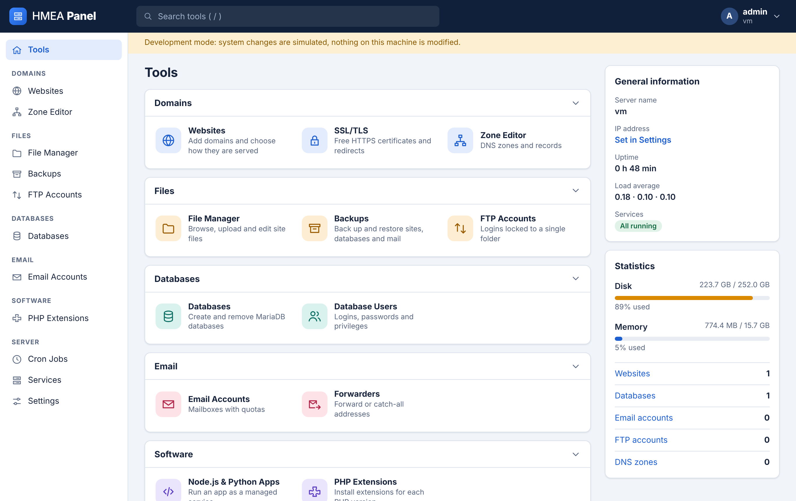
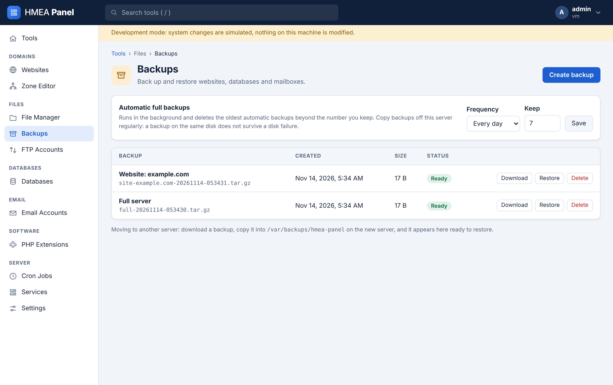

# HMEA Panel

A lightweight web hosting control panel for Ubuntu 22.04/24.04 and Debian 12:
one Go binary (about 13 MB on disk, under 20 MB of RAM when idle) with an
embedded React UI and a SQLite database. No PHP, Perl or database server is
needed for the panel itself.



| Area | What it manages | Backed by |
| --- | --- | --- |
| Websites | Domains, aliases, PHP / static / reverse-proxy sites, enable/disable | Nginx |
| Apps | Node.js and Python (WSGI) sites as managed services, with npm/pip install, restart and logs | systemd, gunicorn |
| HTTPS | Free certificates, HTTP→HTTPS redirect, automatic renewal | certbot (Let's Encrypt) |
| PHP | A version per site, install/remove any extension apt offers, plus sodium (built in) and the SourceGuardian loader | PHP-FPM, apt |
| Databases | Databases, users, passwords, grants, sizes | MariaDB |
| Backups | Full-server, per-site and per-database backups; scheduled backups with retention; restore; download | tar, mariadb-dump |
| Cron jobs | Scheduled commands, run as the web user | cron |
| Files | Browse, upload, edit, rename, delete, download under `/var/www` | built in |
| FTP | Accounts locked to one folder, TLS required | Pure-FTPd |
| Email | Mail domains, mailboxes with quota, forwarders, catch-all | Postfix, Dovecot |
| DNS | Zones and A/AAAA/CNAME/MX/TXT/NS/SRV/CAA records | BIND 9 |

## Try it without a server

```bash
make dev
```

Opens on http://127.0.0.1:8080. In `-dev` mode nothing on the machine is
changed: config files are written under `data/devroot` and commands are only
logged. The generated admin password is in `data/initial-password.txt`.

## Install on a server

On a **fresh** Ubuntu 22.04/24.04 or Debian 12 VPS, as root:

```bash
apt -y install git && git clone https://github.com/eusofali/cPanel-Alter.git /opt/hmea-panel && bash /opt/hmea-panel/install.sh
```

It builds the panel, installs and configures the server software, and
prints the panel address (`https://SERVER:8443`) and the initial admin
password. Options go at the end: `--no-mail`, `--no-dns`, `--no-ftp`,
`--no-apps`, `--no-firewall`, `--php-repo` (more PHP versions and
extensions).

**Full step-by-step guide: [docs/INSTALL.md](docs/INSTALL.md).**

Update later with:

```bash
bash /opt/hmea-panel/update.sh
```

Lost password: `hmea-panel set-password`. Lost authenticator:
`hmea-panel disable-2fa`.

## Built for small servers

- Every PHP site has its own FPM pool in `ondemand` mode: idle sites use no
  PHP workers at all.
- The installer sizes MariaDB to the machine (64 MB buffer pool below 1.5 GB
  RAM, performance schema off) and adds a 1 GB swap file below 2 GB RAM.
- The panel runs with `GOMEMLIMIT=64MiB`; mail, DNS and FTP are optional.

## Security model

- Optional two-factor sign-in (TOTP authenticator apps).
- One admin account: bcrypt password, 12-hour sessions stored hashed,
  `HttpOnly` + `SameSite=Strict` cookies, login throttling per IP, CSRF
  header check, strict Content-Security-Policy, TLS by default.
- Every name that reaches a config file or command is validated against a
  strict pattern; commands are run without a shell.
- Nginx, PHP-FPM and BIND configs are checked (`nginx -t`, `php-fpm -t`,
  `named-checkzone`) and rolled back if rejected.
- PHP sites are confined with `open_basedir` to their own folder, and
  `exec`, `shell_exec`, `system`, `passthru`, `proc_open`, `popen` are
  disabled. Edit `poolTmpl` in `internal/app/sites.go` if an app needs them.
- Node.js and Python apps run as `www-data` in a systemd sandbox that can
  only write inside their own site folder, capped at 512 MB of memory;
  `npm` and `pip` never run as root.
- The file manager resolves symlinks and refuses anything outside `/var/www`.
- The installer enables ufw (only the needed ports, keeping your SSH port)
  and fail2ban, binds MariaDB to localhost, makes BIND authoritative-only,
  and requires TLS for FTP, IMAP and mail submission.

Known limits: the panel runs as root (it has to edit system config), all
sites run as `www-data` (isolation is `open_basedir`, not separate Unix
users), and there is no DKIM signing or spam
filtering for mail. Restrict port 8443 to your own IP if you can:
`sudo ufw delete allow 8443/tcp` then `sudo ufw allow from YOUR_IP to any port 8443 proto tcp`.

## Screens



## Development

```bash
make test
```

Layout: `cmd/hmea-panel` (entry point), `internal/app` (API and services, one
file per area), `internal/sys` (the only code that touches the host),
`web` (React UI), `scripts` (installer, systemd unit).
